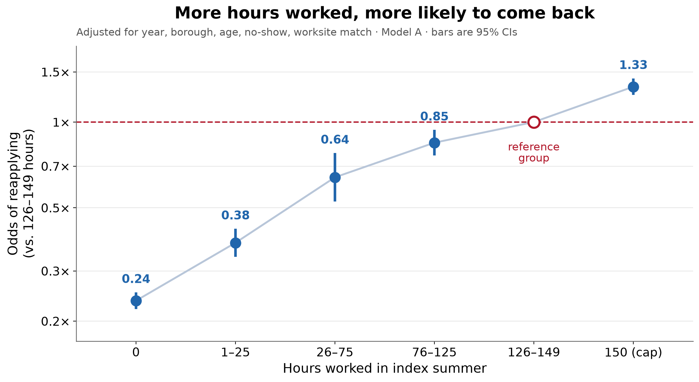
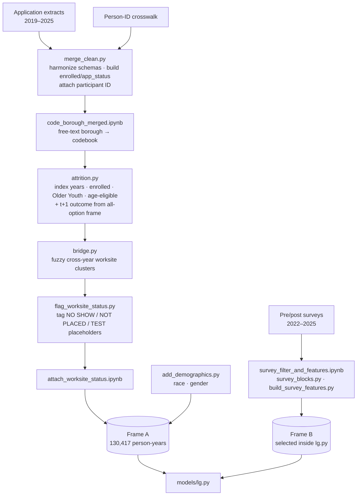
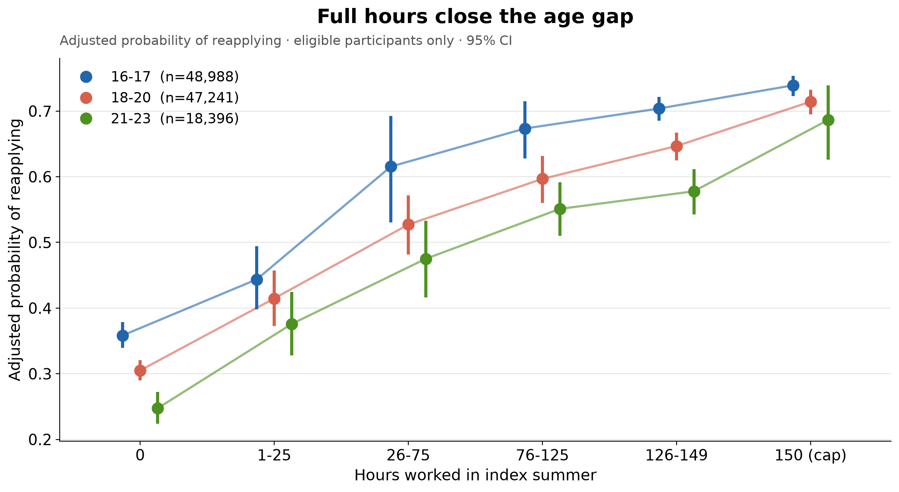
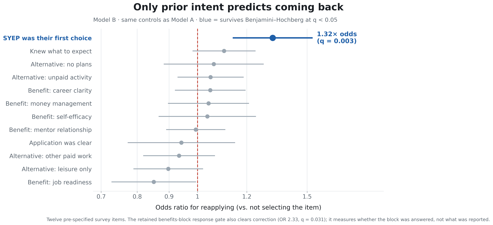
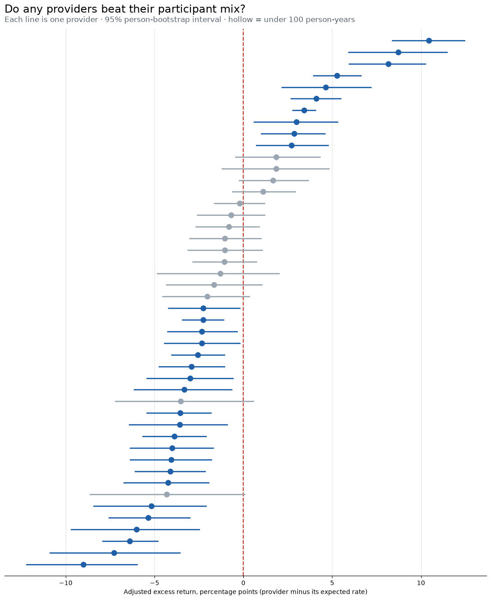

# Who Returns to SYEP?

**Participant, placement, and provider correlates of reapplication to NYC's Summer Youth Employment Program**

An end-to-end analysis built during my summer 2026 analytics internship with the NYC Department of Youth and Community Development (DYCD), Bureau of Planning, Program Integration, and Evaluation. I built it from raw application and survey extracts: identity resolution, cross-year worksite matching, survey feature engineering, cluster-robust logistic regression, and a provider-level analysis.

> **No participant data is in this repository.** It has the code, the documentation, and *aggregate* outputs only (coefficient tables, rates, and figures, each built from thousands of person-years). Provider organizations are de-identified. Running the pipeline requires DYCD data access. See [Data and privacy](#data-and-privacy).
>
> This is my own project write-up. It is not an official DYCD publication, and the findings are not agency positions.

---

## TL;DR

**How much of the program a young person completes is by far the strongest predictor of whether they apply again. What they say about the program afterward predicts almost nothing.**

| | Result |
|---|---|
| **Hours worked** | Monotonic dose-response with no inversions. Youth who worked 0 hours have **0.23×** the odds of reapplying of youth who worked 126–149 hours. Youth who hit the 150-hour cap have **1.28×** the odds. Observed return rates run from **31% → 72%** across the bands. |
| **Self-reported benefits** | None of the five benefit items (career clarity, job readiness, self-efficacy, mentorship, money management) predicts return after FDR correction. All odds ratios fall between 0.85 and 1.05, and the block-level composites rule out effects larger than 1.20×. |
| **First-choice placement** | The **one** survey item that predicts return: youth for whom SYEP was their first choice for what they wanted to do that summer have **1.32×** the odds (q = 0.003), about +5 percentage points. |
| **Providers** | Providers differ jointly (Wald χ²₄₅ = 931). Adjusted "excess return" spans about −9 to +10 pp. Participant mix explains only **~20%** of that spread, so the rest comes from something the data doesn't measure. |
| **Gender** | Male participants have **0.85×** the adjusted odds of female participants (q = 0.008). The result is robust to the clustering choice. |
| **Trend** | Reapplication rose from **55.6% (2022) to 62.8% (2024)**. |

<p align="center">
  
</p>
<p align="center"><sub>Figure from the specification before race and gender were added (0 hrs 0.24, cap 1.33); the current estimates in the table below are 0.23 and 1.28.</sub></p>

Together these point to **allocation and completion, not post-program satisfaction**, as the places where retention is won or lost. These are associations, not causal effects. See [Limitations](#limitations).

---

## Contents

- [Background and research question](#background-and-research-question)
- [Data and privacy](#data-and-privacy)
- [Building the analysis frames](#building-the-analysis-frames)
- [Modeling](#modeling)
- [Results](#results)
- [Limitations](#limitations)
- [Repository layout](#repository-layout)
- [Reproducing the analysis](#reproducing-the-analysis)
- [AI use](#ai-use)
- [Further documentation](#further-documentation)

---

## Background and research question

SYEP places NYC youth aged 14–24 in paid summer jobs through community-based provider organizations. Returning participants matter for two reasons. About 42% of survey respondents first heard about SYEP by having taken part in a past year, and nearly all the rest heard through a friend, family member, or program staff. So who comes back shapes who applies next year, and therefore who the program ends up serving.

**Question.** Among SYEP Older Youth, Community-Based participants, which participant, placement, and provider characteristics are associated with applying again the following year?

| Scoping choice | Decision | Why |
|---|---|---|
| **Outcome** | `returned` = submitted any SYEP application in year *t*+1, to **any** service option | Re-enrollment would measure the lottery as much as the participant. Survey responders reapply at 69% but re-enroll at only 43%, and that ~20-pt wedge reflects capacity limits, not preference. The outcome is built on the all-option frame *before* any Older Youth filter, so a youth who moves to Ladders for Leaders still counts as a returner. |
| **Population** | Older Youth, Community-Based, enrolled in year *t* | One coherent track with a shared provider structure. |
| **Index years** | 2022–2024 (outcome observed 2023–2025) | 2025 cannot be an index year because the 2026 cycle isn't complete. |
| **Age** | 16–23 at program start | A 24-year-old cannot reapply the next year, so including them would build in a guaranteed "non-return". |

---

## Data and privacy

### Sources (not included)

| Source | Raw size | Used for |
|---|---|---|
| SYEP application extracts, 2019–2025 | ~1.03M rows × 185 cols | Enrollment, hours, placement, provider, borough, demographics, prior-participation history |
| SYEP pre/post participant surveys, 2022–2025 | ~151K rows × 634 cols | Counterfactual plans, expectations, perceived benefits |
| Agency-provided person-ID crosswalk | — | Linking applications from the same person across years |

**The identity problem.** The application system issues an ID per *application*, not per *person*, so a longitudinal question is unanswerable without a person key. The agency supplied a de-identified crosswalk that maps each application to a stable participant ID (`pipeline/id_join.py`). Worksites had the same problem, since `worksite_id` is reassigned every cycle. I solved that with a fuzzy-matched cross-year worksite bridge (`pipeline/bridge.py`).

### What is and isn't in this repo

| Included | Excluded |
|---|---|
| All code and notebooks | Every row-level file: raw extracts, merged frames, analysis frames, survey features |
| Coefficient tables, fit statistics, rates with CIs (`results/`) | Model residuals and fitted values per person (`residuals_A.csv`) |
| Figures (`figures/`) | Worksite names and anything keyed to an individual |
| Notebook outputs (aggregate tables only) | Free-text survey responses |
| De-identified provider tables (random pseudonyms, banded sizes, rounded rates) | Real provider names, exact provider counts, provider-by-borough tables; the internal presentation deck |

Guardrails in the code:

- `paths.py` routes every row-level output to `data/` (git-ignored, or wherever `SYEP_DATA_DIR` points).
- `.gitignore` also blocks the known row-level filenames by pattern, in case a path is ever misconfigured.
- Free-text fields (borough, gender, worksite names) are mapped to codebook categories before analysis. Raw strings appear only in the private review files.

### Provider de-identification

The point of the provider analysis is the method: how much variation sits between providers, and whether participant mix explains it. It is not meant to rank named organizations, so providers are de-identified in everything published here.

| Fingerprint | Treatment |
|---|---|
| Name | Random pseudonym (`Provider 01`–`46`). The numbering carries no information about size or rank. |
| Exact counts (person-years, people, returners) | Replaced by a size band: under 1,000 / 1,000–2,499 / 2,500+ |
| Return rate, adjusted excess | Rounded to whole percentage points, so the unlabeled caterpillar plot can't be matched row-for-row to the table |
| Confidence intervals, per-provider age/hours/no-show composition, fixed-effect ORs | Dropped from the public tables. Whether the interval excludes zero is kept as yes/no. |
| Provider × borough shares | Not published; only the summary statistic (52% of providers draw >90% of youth from one borough) |

The pseudonym key and the full-precision tables are written only to the private data directory. The script fails if any real provider name survives anywhere in `results/`.

---

## Building the analysis frames



### Frame A — administrative (headline estimates)

The unit is the person-year: one row per participant per index year.

The filtering path is logged step by step in `attrition.py`: index years 2022–2024 → enrolled in year *t* → Older Youth → has a participant ID → one row per (person, year) → age known → age-eligible at *t*+1.

| | 2022 | 2023 | 2024 | Pooled |
|---|---|---|---|---|
| Person-years at risk | 41,757 | 43,652 | 45,008 | **130,417** |
| Return rate | 55.6% | 59.6% | 62.8% | 59.4% |
| Median paid hours | 137 | 136 | 142 | 139 |
| Zero paid hours | 18.3% | 17.9% | 17.2% | 17.8% |
| Provider recorded | 62% | 100% | 100% | 88% |

The provider-complete subset (**114,625** person-years) is what every provider-clustered model is fit on.

Data work for Frame A:

- **Placeholder worksites.** Many "worksites" are not sites: `NO SHOW`, `NOT PLACED`, test records. `flag_worksite_status.py` classifies these by pattern and collapses no-shows into a single sentinel cluster so they don't masquerade as a real site. Two participant-level flags come out of this step: `is_no_show` and `worksite_matched`.
- **Borough.** The borough field is free text, and people type neighborhoods ("Bed-Stuy", "Washington Heights"). `codebook_validator.py` fuzzy-matches each distinct value against a codebook. Two guards keep it from auto-assigning: multi-token entries and close-call matches both go to manual review. Low-confidence matches land in a review CSV for hand correction.
- **No-show flag vs. hours.** The `is_no_show` flag catches only about a third of youth who never worked (`notebooks/exploration/prereg_checks.ipynb`). So `total_hours_paid = 0` is the behavioral measure, and the flag is kept as a data-quality covariate.

### Frame B — survey (secondary, explicitly selected)

Survey response is voluntary and requires enrollment, so respondents are **not** a random sample of Frame A. The two frames are therefore never pooled. Frame B is one row per person, taken at that person's **first** observed Frame A year:

| Step | n |
|---|---|
| Matched pre/post survey person-years | 8,882 |
| − no matching Frame A person-year | −1,327 |
| − surveyed *after* their first program year (outcome would be conditional on prior participation) | −1,038 |
| **Frame B participants** | **5,844** |
| − missing provider (cannot be clustered) | −1,059 |
| **Estimated in `B_survey`** | **4,785** |

The 1,038-person drop is controlled by `REQUIRE_SURVEY_AT_EARLIEST_A_YEAR`. Both sample sizes are logged, so the trade-off is a documented number rather than a hidden default.

**Survey features.** Each checkbox question in the export is spread across 5–15 columns. `survey_blocks.py` declares each question once as a `BlockSpec`, discovers its item columns from the question stem (so a typo raises an error instead of silently dropping an item), and collapses the block into a few theoretically grouped indicators. Twelve pre-specified items across three blocks reached the model:

| Block | Wave | Items |
|---|---|---|
| `cf_*` — what they'd have done otherwise | Pre | paid alternative · unpaid activity · leisure only · no plans |
| `expect_*` — entry expectations | Pre | application clarity · **SYEP was my first choice** · knew what to expect |
| `benefit_*` — perceived benefits | Post | career clarity · job readiness · self-efficacy · mentor relationship · money management |

Skipping a whole question looks identical to checking no boxes. To tell them apart, each block carries an `_answered` gate. Gates that are a deterministic function of the items are detected and dropped (`check_gates()`). Full definitions, endorsement rates, and the reasoning behind every dropped block are in [`docs/survey_features.md`](docs/survey_features.md).

---

## Modeling

All model code is in [`models/lg.py`](models/lg.py). The complete design record, including every amendment and the reasoning behind it, is in [`docs/model_design.md`](docs/model_design.md).

### Specification

Logistic regression via `statsmodels` with `patsy` formulas:

```
returned ~ bs(age_on_start, df=3)                              # spline: return propensity is non-linear in age
         + C(hours_band, Treatment(reference="126-149"))       # 0 / 1–25 / 26–75 / 76–125 / 126–149 / 150 (cap)
         + C(Year) + C(borough)
         + is_no_show + worksite_matched                       # placement / record quality
         + C(race) + C(gender)                                 # references set to the modal observed level
         [+ 12 survey items + retained gates]                  # Frame B only
```

- **Reference band is 126–149 hours, not 0.** Each hours coefficient therefore reads as "worked less (or more) than full-time" rather than "worked at all", which would confound dose with participation.
- **`worked_zero_hours` is not a separate term.** It is identical to the `0` level of `hours_band`, so including it would make the design rank-deficient.

### The four fits

| Fit | Frame | SEs clustered on | Purpose |
|---|---|---|---|
| `A_full` | A, provider-complete | provider (46) | **Headline estimates** |
| `A_person_clustered` | same rows as `A_full` | participant | Checks whether repeated-person dependence changes inference. The pipeline asserts identical *n* and identical point estimates. |
| `A_survey_subsample` | A, restricted to Frame B's exact person-years | provider | **Bridge model.** It separates *who answered the survey* from *what they answered*. |
| `B_survey` | B | provider | Survey-augmented model |

### Inference choices

- **Clustered standard errors.** Youth at the same provider share recruitment, placements, and staff, so I clustered on provider. Worksite was rejected as the cluster variable because, at a median of 3 youth per site, it is effectively a row ID.
- **Multiple testing.** Benjamini–Hochberg FDR is applied *within* each fit. In `B_survey`, only the pre-specified survey items form the family; administrative covariates are adjustment terms, not hypotheses.
- **Pre-specification.** Predictors and family membership were fixed before any outcome cross-tabs were examined. Low-variance items were dropped on endorsement rate alone, before looking at any association with the outcome.

### Validation built into the pipeline

The pipeline separates conditions that should **drop rows and log them** from conditions that should **halt**:

- **Halts:**
  - duplicate person-years
  - a 100% survey-to-admin non-match, which is almost always an ID dtype bug, not attrition
  - non-numeric survey values
- **Drops and logs:**
  - expected attrition
  - terms that are constant within a subset
- **Reports, without enforcing** (written to `diagnostics.txt`):
  - design rank and Belsley scaled condition index for each fit
  - univariate separation screening and thin-cell flags
  - provider coverage by year

### Secondary analyses

| Script | Question | Method |
|---|---|---|
| `models/age_analysis.py` | Do the hours and first-choice gaps differ by age? | Interaction models; g-computation adjusted probabilities by age group; difference-in-differences with 2,000-draw parametric bootstrap CIs |
| `models/block_tests.py` | Is each survey *block* jointly null? Is the first-choice result sensitive to gate specification? | Block Wald tests (BH-corrected); KR-20 reliability for composite counts; region-of-practical-equivalence check (ROPE: 1.20×) |
| `models/provider_analysis.py` | Do providers differ after adjusting for who they serve? | Provider fixed-effects Wald and LR tests; per-provider adjusted excess return (observed − expected) with person-bootstrap CIs; rank shifts; second-stage regression on provider composition |
| `models/provider_stability.py` | Is a provider's position stable from 2022–23 to 2024? | Split-period excess with bootstrap-corrected reliability *(written; results not yet included)* |
| `notebooks/exploration/prereg_checks.ipynb` | Where does outcome variance sit: provider or worksite? | Sequential and nested ANOVA |
| `notebooks/exploration/brooklyn_provider_mix.ipynb` | Is Brooklyn's higher rate a provider-mix effect? | Direct standardization to the pooled provider mix |

---

## Results

All numbers come from [`results/models/`](results/models/). The current `coefs.csv` includes the race and gender covariates.

### 1. Hours worked: a monotonic dose-response

`A_full`, n = 114,625, pseudo-R² = 0.078:

| Hours in index summer | Adjusted OR | 95% CI | Observed return rate |
|---|---|---|---|
| 0 | **0.23** | 0.22 – 0.25 | 31.2% |
| 1–25 | **0.37** | 0.33 – 0.42 | 38.4% |
| 26–75 | **0.62** | 0.52 – 0.73 | 54.5% |
| 76–125 | **0.83** | 0.76 – 0.90 | 61.6% |
| 126–149 | *reference* | — | 65.6% |
| 150 (cap) | **1.28** | 1.15 – 1.42 | 71.8% |

- **No inversions.** Every hours contrast survives BH correction at q < 0.001.
- **No-show status adds nothing once hours are in the model** (OR 1.04, q = 0.56). No-shows *are* the zero-hours band. The risk isn't "who no-showed", it's "who accumulated few hours", which is a broader group.
- **The gap is the same at every age.** The adjusted gap between 0 and 126–149 hours is about **34 pp** in every age group (16–17: 34.6, 18–20: 34.2, 21–23: 33.1), and no between-group difference separates from zero.

<p align="center"></p>

### 2. Survey items: one signal, many nulls

`B_survey`, n = 4,785:

<p align="center"></p>

- **First-choice placement:** OR **1.32** (1.14 – 1.53), q = 0.003. It is stable when every block gate is forced into the model.
- **Benefits block:** jointly null (Wald q = 0.28). The benefit composite has KR-20 = −0.19, meaning the items don't scale together, so the block test is the right summary rather than the count.
- **Expectations block:** significant (q = 0.004), but only because of first choice. Without that item it is null (q = 0.28).
- **Bridge model:** the same administrative specification on survey responders keeps the low-hours gradient (0 hours OR 0.25, 95% CI 0.12 – 0.51). The pseudo-R² drops from 0.078 to 0.027 because responders are 98.8% completers, so the hours variance is truncated.

The only survey item that predicts return isn't about how the program *felt*. It's about whether the young person wanted to do SYEP, as their first-choice summer activity, in the first place.

### 3. Providers differ, and participant mix doesn't explain it

<p align="center"></p>

- **Providers differ jointly.** Person-clustered Wald χ²₄₅ = 931 (p < 10⁻¹⁶⁰). Pseudo-R² goes from 0.078 to 0.085 with provider fixed effects.
- **31 of 46 providers** have an adjusted excess return whose 95% interval excludes zero. The range is −9.0 to +10.4 pp (SD 4.2 pp).
- **Adjustment barely moves the ranking.** It shrinks the spread by only 19.6% (raw SD 5.2 → 4.2 pp), and raw and adjusted rankings correlate at Spearman ρ = 0.87. So provider differences are *not* explained by the participant characteristics in the model. That does not make them provider *effects*: the cause is unmeasured.
- **Worksite matters more than provider.** In the pre-registration ANOVA, worksite adds 4.9 pts of R² beyond provider, while provider adds only 0.3 beyond worksite. Much of the “provider” variation is plausibly which worksites a provider runs. However, youth apply to providers, not worksites, and can’t know in advance which worksite they’ll be placed at, so the worksite effect reflects provider placement decisions rather than youth choice.
- **Brooklyn is partly a provider-mix story.** Its higher raw rate (62.8% vs 59.4% pooled) is partly driven by one large, high-return provider. But standardizing to the pooled provider mix closes only about a third of the gap.

### 4. Demographics and context

- **Gender.** Male participants have adjusted OR **0.85** (0.77 – 0.95, q = 0.008) relative to female participants. The point estimate is identical under person clustering, with a narrower interval (0.83 – 0.88). In the survey subsample the direction is the same but the result isn't significant (OR 0.90, p = 0.15), which is consistent with that sample's lower power.
- **Year.** 2023 vs 2022: OR 1.20. 2024 vs 2022: OR 1.32. I report these as context, not as a program effect.
- **Borough.** Not significant under provider clustering (Brooklyn q = 0.17), but strongly significant under person clustering (q < 0.0001). Providers nest within boroughs, so provider clustering is the right and more conservative choice. Here, the inference decision changes the conclusion.
- **Race.** Coefficients are estimated, but I would not interpret them as reported. Changes in how race/ethnicity was recorded left some categories very sparse (only 277 of 114,625 person-years are coded “Hispanic”), so the coefficients likely reflect how race was recorded rather than real differences between groups.
---

## Limitations

- **Association, not causation.** Hours worked is endogenous. Whatever engagement keeps a young person on site to 150 hours plausibly also brings them back. This does **not** show that assigning more hours would raise retention.
- **Where, not why.** The analysis locates attrition early in the placement but doesn't explain any individual's decision. The survey was designed for pre/post attitude change, and its items are ceiling-loaded satisfaction measures.
- **The survey describes completers.** Responders return at 69.6% vs 56.1% for non-responders. 20.0% of non-responders worked zero hours, compared with 1.2% of responders. That gap is by construction, since a matched pre/post response requires completing the program.
- **Provider missingness.** Provider is unrecorded for 37.8% of 2022 person-years and 0% after. The provider-clustered fits are therefore lighter on 2022 than the raw frame.
- **Clustering rests on 46 providers.** That is near the conventional floor for cluster-robust asymptotics.
- **Return measures revealed demand, not benefit.** Coming back is not the same as the program having worked, and you can't learn anything about youth who never enrolled.

### What I'd do next

1. **Use the model for early attrition.** Its real use is identifying who leaves early, which holds regardless of how "success" is defined.
2. **Fix two administrative fields.** First, a worksite ID that persists across cycles. Second, an industry code for the specific placement rather than the worksite in general.
3. **Use more of the survey.** The one-row-per-person design made most items unusable. A cross-sectional specification wouldn't have that constraint, and the richer 2022-only relational battery (n ≈ 2,500) is a viable separate model.
4. **Test provider stability year to year** (`provider_stability.py`) before any provider ranking is used for decisions.

---

## Repository layout

```
.
├── README.md
├── paths.py                  # every file location; set SYEP_DATA_DIR to keep data outside the repo
├── requirements.txt
│
├── pipeline/                 # raw extracts → analysis frames
│   ├── merge_clean.py          harmonize 2019–2025 extracts, build enrollment, attach person ID
│   ├── id_join.py              application → participant ID crosswalk join
│   ├── prune.py                column selection with documented drop reasons (PII, constants, duplicates)
│   ├── codebook_validator.py   fuzzy-match free text to a codebook, with a human review step
│   ├── attrition.py            filter waterfall + t+1 outcome → analysis_frame.csv
│   ├── bridge.py               cross-year worksite clustering (rapidfuzz, blocked)
│   ├── flag_worksite_status.py tag placeholder worksites, collapse no-shows
│   ├── survey_blocks.py        BlockSpec: declare a checkbox battery once, audit, collapse
│   ├── build_survey_features.py  wide survey feature frame
│   └── add_demographics.py     person-level race and gender
│
├── models/                   # estimation
│   ├── lg.py                   Frames A/B, four fits, BH, diagnostics      ← start here
│   ├── age_analysis.py         age interactions, g-computation, bootstrap DiD
│   ├── block_tests.py          block Wald tests, gate sensitivity, composites
│   ├── provider_analysis.py    provider FE tests, adjusted excess return
│   └── provider_stability.py   split-period provider reliability
│
├── descriptives/             # tables and figures
│   ├── cohort_table.py         cohort and subgroup tables → results/descriptives
│   ├── cohort_plots.py         figures from the cohort tables
│   ├── frame_plots.py          Frame A vs B descriptives, survey item panels
│   ├── gender_plot.py          gender adjusted-probability figure
│   └── disclosure.py           provider de-identification for published outputs
│
├── notebooks/
│   ├── pipeline/             # notebook steps in the build (see run order)
│   └── exploration/          # pre-registration checks and one-off investigations
│
├── results/                  # aggregate outputs only
│   ├── models/                 coefs.csv, fitstats.csv, diagnostics.txt, …
│   └── descriptives/           cohort_table.csv, return_by_*.csv, descriptives.md
├── figures/
│   ├── models/
│   └── descriptives/
│
└── docs/
    ├── findings.md             first full write-up of results
    ├── model_design.md         design record for lg.py, including amendments
    └── survey_features.md      survey block dictionary
```

---

## Reproducing the analysis

Running this requires the DYCD source extracts, which are not public. With access:

```bash
python -m venv .venv && source .venv/bin/activate
pip install -r requirements.txt
export SYEP_DATA_DIR=/path/to/secure/SYEP/data   # expects raw/ inside; defaults to ./data
```

Run from the repo root, in order:

| # | Step | Reads → writes (all under `$SYEP_DATA_DIR` unless noted) |
|---|---|---|
| 1 | `python pipeline/merge_clean.py` | `raw/applications*.csv`, `raw/unique_ids.csv` → `processed/merged.csv` |
| 2 | `notebooks/pipeline/code_borough_merged.ipynb` | → `to_use/merged.csv` (all-option outcome lookup) |
| 3 | `python pipeline/attrition.py` | → `to_use/analysis_frame.csv`, `results/descriptives/attrition_waterfall.csv` |
| 4 | `notebooks/pipeline/code_borough_analysis_frame.ipynb` | borough codebook on the analysis frame |
| 5 | `python pipeline/bridge.py` | → `to_use/worksite_bridge.csv` |
| 6 | `python pipeline/flag_worksite_status.py` | → `to_use/worksite_bridge_status.csv` + review files |
| 7 | `notebooks/pipeline/attach_worksite_status.ipynb` | → `to_use/analysis_frame_worksite.csv` (**Frame A**) |
| 8 | `notebooks/pipeline/survey_filter_and_features.ipynb` | `processed/surveys.csv` → `to_use/survey_features_wide.csv` |
| 9 | `python pipeline/add_demographics.py` | race and gender per participant; `lg.py` expects `race` and `gender` on Frame A |
| 10 | `python models/lg.py` | → `results/models/` (+ private `to_use/models/residuals_A.csv`) |
| 11 | `python models/{age_analysis,block_tests,provider_analysis,provider_stability}.py` | → `results/models/`, `figures/models/` |
| 12 | `python descriptives/{cohort_table,cohort_plots,frame_plots,gender_plot}.py` | → `results/descriptives/`, `figures/` |
| 13 | `python descriptives/disclosure.py` | de-identifies provider outputs in `results/`; key and full-precision copies → `to_use/` (**run before every commit**) |

**Read `results/models/diagnostics.txt` before quoting any number.** It holds the sample sizes, dropped-row accounting, coverage cross-tabs, and design checks behind every coefficient.

Notes on the run:

- Survey preprocessing upstream of step 8 (stacking the pre/post exports into `processed/surveys.csv`) happened outside this repo.
- `notebooks/pipeline/survey_first_year_only.ipynb` is superseded. `lg.py` now does the first-year selection against Frame A.
- The model scripts write real provider names and exact counts into `results/`.

---

## AI use

I used an AI assistant (Claude, by Anthropic) for parts of this project:

- **Preparing the public repository.** After my own review, the AI audited the repository for sensitive content, reorganized the folder structure, and moved file paths into `paths.py`. It also helped design and write `descriptives/disclosure.py`, the de-identification step that keeps providers from being identifiable by people who know the program.
- **Documentation.** Much of the in-code documentation — docstrings, comments explaining design decisions, and the notebook headers — was written or expanded with AI assistance (a kindness to future me, who would otherwise have no idea what any of this does), as was this README, which was drafted from my code, results, and existing write-ups (`docs/`). I reviewed all of it against the code and result files.
- **Code assistance.** Some pipeline modules were drafted or debugged with AI help, as noted in their file headers. I specified, reviewed, and tested all of them.

The research question, analytic design, modeling decisions, and interpretation of results are my own. The AI-assisted cleanup was done on the finished repository, not on the raw application or survey extracts.

---

## Further documentation

- [`docs/model_design.md`](docs/model_design.md): frame construction, specification, the four fits, BH families, validation gates, and the design amendments made along the way.
- [`docs/survey_features.md`](docs/survey_features.md): every survey block, its items, endorsement rates, and why blocks were kept or dropped.
- [`docs/findings.md`](docs/findings.md): the first full results write-up (pre-demographics specification).
- [`results/descriptives/descriptives.md`](results/descriptives/descriptives.md): all descriptive tables in one place.

---

**Sonia Tyburczy** · Analytics Intern, NYC DYCD (Summer 2026) · Mathematics, Baruch College (CUNY)
[github.com/soniatyburczy](https://github.com/soniatyburczy) · me@soniatyburczy.com
